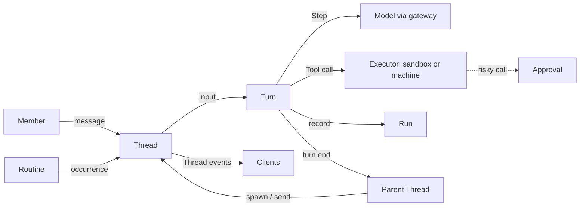

# 001 Domain model

This document names the concepts of Guild and the rules each one keeps. The code, the wire, the clients and the later documents use these terms. Following [000 Principles](000-principles.md), the model holds only the concepts the work needs.

## Flow

Work enters a Thread as an Input. A Member writes one, a Routine fires one, or a parent Thread spawns or messages a child. The Thread's Agent runs a Turn on it. The Turn calls the model through the gateway, one Step at a time. It calls Tools on an Executor, and a risky call waits for an Approval. A Run records each Turn: what started it, who it acted for and how it ended. A child Thread's Turn end comes back to its parent as an Input. Everything the Turn produced is appended to the Thread's events and pushed to the clients that show it.

## Concepts

Agent, Thread, Turn and Executor form the core; the rest supports them.

| Concept | Definition | Rules it keeps | Why it exists |
| --- | --- | --- | --- |
| Org | The tenant that owns every record, key and member | Every row carries its org. Nothing crosses orgs. Provider keys, integration secrets and the model catalog are per org | The org owns its data and pays for its models |
| Member | One person in an Org, with a role (`admin` or `member`) and an identity (`managed` password or `oidc`) | An Org always keeps at least one admin. Revoking a member's credentials revokes all of them at once (see 002) | Every action and every token is attributed to someone |
| Team | A group of Members | Used for agent grants and usage attribution. It holds no data of its own | Sharing and cost reporting at a group level |
| Agent | A named, persistent worker: instructions, one model, a tool allowlist, a visibility and a Workspace | Has one owner. Each Member has exactly one personal Agent, which stays private and cannot be archived or deleted. Other Agents are shared as `private`, `team` or `org`. Lifecycle: `active` → `archived` or `deleting` → purged. Only an `active` Agent starts Runs | Whoever does the work, with the same configuration for everyone who uses it |
| Workspace | The Agent's private directory: its files, its `AGENTS.md` and `MEMORY.md`, and its notes | One per Agent, shared by every Member who uses the Agent. Tools reach it only inside the Agent's sandbox. It is never merged with a project folder | Durable memory and working state that outlive any one Thread |
| Thread | One conversation between an Agent and the Member it belongs to; `chat` in storage and on the wire | Links one Agent, one Member and optionally one Project. Is of type `user`, `subagent` or `routine`. Each (Agent, Member) pair has one default Thread. Only its Member writes to it. A spawned Thread names its parent, and that link is the only tree edge | The unit of history, privacy and live display |
| Thread event | One row of a Thread's append-only log, with a sequence number | Never edited. Read state, unread state and the client's view are all derived from it | The durable record clients render and resume from |
| Input | One queued instruction for a Thread's Agent: a Member's message, a posted Turn, a child result, a compaction summary, a posted agent message or a notice | Takes one of three placements: `steer` joins the running Turn at the next tool boundary, `followUp` starts the next Turn, `write` lands at once when idle, else at the next boundary, without starting a Turn. A Member's message is admitted once per message id | Separates "what was asked" from "when the Agent takes it" |
| Turn | One continuous piece of Agent work on a Thread: Steps until the model stops calling tools | Only one Turn runs on a Thread at a time. It survives a restart and resumes from its recorded Steps. Stop ends it at the next Step | The unit of execution and of durability |
| Step | One model call inside a Turn, with the Tool calls it requested | Numbered within its Turn | The unit of cost, tracing and steering |
| Run | The record of one Turn: its trigger, the Member it acted for, its status and its final text | One Run per Turn: it opens before the Turn's first model call and settles when the Turn ends, never earlier. Trigger is `message`, `routine`, `manual` or `delegation`. Settles exactly once to `succeeded`, `failed`, `silent`, `skipped` or `cancelled`. Always names a Member | Activity, attribution, and the result a parent or routine waits on |
| Tool call | One model-requested invocation and its result | Runs on exactly one Executor. A shell command passes exec policy before any Approval. A large result is stored as a Tool artifact, and the model still sees it in full | Everything an Agent does outside the model |
| Executor | Where a Tool call runs: the Agent's sandbox (`server`) or a Member's paired Machine (`machine`) | A Thread bound to a Project runs file and shell tools on that Project's Machine. Its Agent still reaches its Workspace through the `agent_*` tools. Other Threads run everything in the sandbox | Contains execution, and puts it where the files are |
| Approval | A Tool call waiting for the Thread owner's answer | Only the Thread's owner answers. The first answer wins. No answer within the timeout counts as a denial. Stored as a pair of Thread events | A person decides what is risky |
| Machine | One paired desktop host that can run tools | Belongs to one Member and is identified by a hardware fingerprint. It is online only while it holds its live socket slot. A tool call on an offline Machine fails explicitly | The Member's own files and environment |
| Project | A named folder on one Machine | Belongs to one Member. One live Project per (Machine, folder). Archiving frees the folder. A Machine with bound Projects cannot be removed | Gives a Thread its working directory and project instructions |
| Routine | A saved prompt an Agent runs on a schedule (`cron`) or once (`once`); a reminder is a `once` Routine the Agent sets itself | Runs on behalf of its creator, only while the creator can still use the Agent. Each scheduled instant is one Occurrence. A Run's messages go to the Routine's feed Thread or to a new Thread each | Work nobody has to ask for each time |
| Occurrence | One scheduled instant of a Routine | `(routine, scheduled_for)` is unique. It is claimed once, retried up to three times, and then fails with a Notice | Idempotent scheduling across restarts and processes |
| Notice | One item in a Member's agent inbox: an agent message, a routine failure or a routine disable | Per Member, with a read marker | Tells a person what happened without them asking |
| Attachment | A file carried by a message, in either direction | Its bytes are frozen in object storage when it is attached. For one Turn it is materialized outside the Workspace, at `/tmp/attachments/<run>/` | Files move between people and agents without copying into workspaces |

Aggregates: an **Agent** holds its Workspace, Routines, grants and Runs. A **Thread** holds its events, its Input queue, its approval mode and its child Threads. A **Run** belongs to one Thread and one Agent and refers to its parent Run when it was delegated. A **Member** holds their Machines, Projects, Notices, skill installs and read markers.

Capabilities are what a Turn can use. They are defined in [004 Capabilities](004-capabilities.md): the model behind a Step (a Model route), the Tools on offer (built-in tools, Integration tools, MCP tools) and the knowledge the Agent loads (Skills).

## Rejected concepts

| Rejected | Reason |
| --- | --- |
| A plain-chat runtime beside the agent runtime | Two paths drift. A Thread without an Agent is adopted by its Member's personal Agent at its first Turn |
| A per-Thread model override | The model is a property of the Agent, so every Member of a shared Agent gets the same worker |
| A per-Member workspace on a shared Agent | One Workspace per Agent is the product: sharing an Agent shares its files, never its Threads |
| Sharing a Thread, or Threads with several Members | A Thread is private to its Member. Several participants per Thread would be a future `participants` relation, not a flag |
| A separate "session" or "call" noun for agent-to-agent work | A spawn creates one Thread, and that Thread is the tree node |
| A `wait` tool, or a parent blocking on a child | The parent ends its Turn. The child's Turn end arrives as an Input |
| Upward messages other than a Turn end, such as `needs_input` | A child that needs a decision ends its Turn with the question |
| A Member posting into a child Thread | Authority flows down the tree only. A Member can read and cancel a child Thread, not write to it |
| Copying deliverables into a Workspace | Files travel as Attachments on messages, and the Workspace holds working state only |
| A token or time budget for an agent tree | The tree is bounded by its shape: depth and children per node |
| An org-wide cap on Agent count | The limits are workspace quota and storage, not a count |
| Telling the Member about workspace conflicts | Two Turns writing the same file is the Agent's problem. The warning goes into the Agent's context |
| Agent identity files (`SOUL.md`, `IDENTITY.md`, `USER.md`) | Name and description live on the Agent. Only `AGENTS.md` and `MEMORY.md` ride the prompt |
| A chat-scoped or agent-scoped attachment directory | One sandbox serves every Thread of an Agent, so only a Turn-scoped path keeps one Member's files from another's Turn |

## What is fixed and what each Org sets

The concepts and their rules are fixed. Each Org supplies the content:

| Part | Set by the Org |
| --- | --- |
| Members and Teams | Users, roles, teams, and an optional OIDC provider |
| Agents | Instructions, model, tool allowlist, visibility, Workspace contents and Routines |
| Models | Providers, Model routes, aliases, prices and monthly quotas |
| Tools | Enabled Integrations and their curated tools, role policy, and Members' own MCP servers |
| Skills | The registry catalog, its reviews, and each Member's installs and pins |
| Prompts | The assistant prompt and the auto-approval policy prompt |

## Glossary

The later documents explain the terms not introduced above. The **In code** column names the table or type where the code's word differs from the domain's.

| Term | Meaning | In code |
| --- | --- | --- |
| Org | The tenant | `orgs` |
| Member | A person in an Org | `users` |
| Admin | A Member with the `admin` role | `role = 'admin'` |
| Team | A group of Members | `teams` |
| Agent | A persistent worker | `agents` |
| Personal agent | The one private Agent each Member has, named Assistant by default | `agents.is_personal` |
| Workspace | An Agent's directory | `agents/<org>/<agent>` on the workspace volume |
| Thread | A conversation of an Agent with a Member | `chats` + `agent_threads` |
| Default thread | The (Agent, Member) home Thread | `agent_threads.is_default` |
| Thread event | One row of a Thread's log | `thread_events` |
| Input | Queued instruction for a Thread | inbox item |
| Turn | One continuous piece of Agent work | a pi-durable run; `generation` on the wire |
| Step | One model call in a Turn | `step` |
| Run | The record of a Turn | `agent_runs` |
| Turn command | A queued stop, steer or withdraw for a Turn | `turn_commands` |
| Tool call | One tool invocation and its result | `tool_call` / `tool_result` events |
| Tool artifact | A large tool result kept in object storage | `tool_artifacts` |
| Executor | Where a Tool call runs | `executorKind`: `server` or `machine` |
| Sandbox | The gVisor container that runs an Agent's server-side tools | `sandbox-runner` |
| Approval | A Tool call waiting for the owner | `approval_request` / `approval_decision` events |
| Exec policy | Static rules for shell commands | `exec_policy_base.rules` |
| Machine | A paired desktop host | `machines` |
| Machine link | A Machine's live socket to the server | machine socket |
| Project | A folder on a Machine | `projects` |
| Routine | A scheduled or one-shot prompt | `agent_routines` |
| Reminder | A `once` Routine an Agent set for itself | `schedule_reminder` |
| Occurrence | One scheduled instant of a Routine | `agent_routine_occurrences` |
| Feed thread | The one Thread a Routine delivers into | `agent_threads.routine_feed` |
| Notice | An item in a Member's agent inbox | `agent_notices` |
| Attachment | A file on a message | `attachments` |
| Child result | A child Thread's Turn end, delivered to its parent | `child_result` event |
| Model route | One model name mapped to a provider, key, price and quota | `model_routes` |
| Integration | A third-party service the Org connects | `integrations` |
| Skill | A published instruction bundle | registry item of kind `skill` |
| Member socket | A client's one WebSocket to the server | `/api/v1/ws` |
| Frame | One message on a socket | `ServerFrame` / `WsServerMsg` |

| Group | Values |
| --- | --- |
| Role | admin · member |
| Agent visibility | private · team · org |
| Agent status | active · archived · deleting |
| Thread type | user · subagent · routine |
| Input placement | steer · followUp · write |
| Run trigger | message · routine · manual · delegation |
| Run status | queued · running · succeeded · failed · silent · skipped · cancelled |
| Executor | server · machine |
| Approval mode | ask · approve_for_me · full_access · default |
| Exec policy decision | allow · prompt · forbidden |
| Tool class | read · write · admin |
| Routine kind | cron · once |
| Routine delivery | thread · new_chat |
| Occurrence status | pending · claimed · done · failed · skipped |
